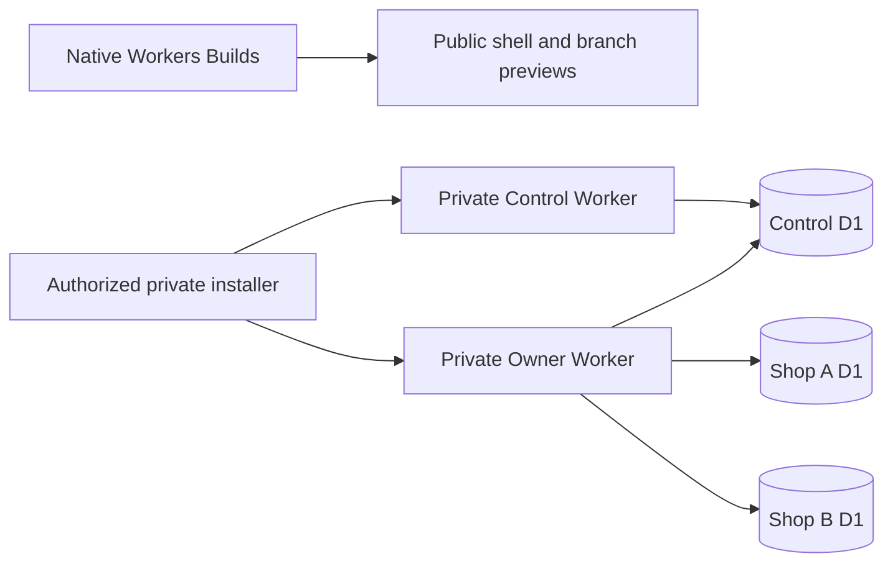

# PORT-00 P2 provisioning and recovery design

[PORT-00 #699](https://github.com/shuvodelux-commits/SherERP_Cloud/issues/699) owns this disposable rehearsal design.
It follows the merged [P1 configuration contract](PORT_P1_LOCAL_CONFIGURATION.md)
and [P2 GET-only preflight](PORT_P2_READONLY_PREFLIGHT.md) at
`main@69dfca03df19d990c81d673e71587b42c6397514`. M03 owns the shared
bindings, schema and runtime, M04 reviews identity and ingress, M10 owns the
recovery check, and M11 reviews deployment ownership. The design needs review
and separate authorization for remote execution. The clean-shop purchase work
under #690 can proceed independently under its existing gates.

## Decisions for the disposable rehearsal

**Use one private Control Worker and one private Owner ERP Worker.** The
Control Worker binds only Control D1. The Owner Worker binds Control D1 for
current Owner authority and exactly one static, named D1 binding per shop.
Start with Shop A and Shop B in an otherwise empty disposable account. Each
gets an independent D1. A new binding is a new Owner Worker version. This
adopts Candidate A from the [P0 topology review](PORT_00_P0_INSTANCE_AND_BINDING_ADR_CANDIDATE.md)
for the rehearsal. A Worker per shop multiplies deployments and ingress
configuration. Revisit static shards only if measured capacity or rollout
impact makes a single Worker unsuitable. Cloudflare exposes D1 through
declared environment bindings and captures bindings in version metadata.
[Worker D1 API](https://developers.cloudflare.com/d1/worker-api/d1-database/),
[Worker versions](https://developers.cloudflare.com/workers/versions-and-deployments/).

**Give the private installer sole deployment ownership of the two disposable
Worker names.** The operator runs it against a reviewed GitHub SHA and
generates private configuration from the verified resource inventory. All
upload, promotion and rollback for these names go through that installer.
Private Worker names have no Workers Builds repository connection,
deployment hook or GitHub Actions deploy job. Workers Builds retains sole
ownership of `hisabiq`: `main` serves the inert shell and other branches get
DB-free Worker Previews. GitHub Actions validates the repo and builds test
artifacts without deploying. This division keeps static binding changes and
app-version changes under the same serialized private publisher.
[Workers Builds branch behavior](https://developers.cloudflare.com/workers/ci-cd/builds/build-branches/).

For the private rehearsal, start with ingress disabled and `preview_urls:false`.
Configure separate Cloudflare Access policies on the exact Admin and Owner
`workers.dev` hosts before enabling those hosts. Require the approved tester
identities and exact origins, including Google Web origin and redirect
configuration for the flow under test. Verify denial for anonymous and
unapproved callers on HTML, assets and APIs, and confirm that no alternate
route or preview hostname can serve the private Worker. Access gates ingress.
Current app authority still governs a Shop request. Keep invitations, Owner
login and ERP write flags disabled through P2. P3/P4 own actual enrollment
and activation. [Cloudflare Access for Workers](https://developers.cloudflare.com/workers/configuration/cloudflare-access/).

## Provisioning contract

| Phase | Required evidence and next action |
| --- | --- |
| Plan | Validate a versioned local intent containing account and namespace, two Worker names, two shop IDs, stable deterministic resource names, release SHA, exact migration file digests and expected empty inventory. Reserve the operation ID and record its intent digest before any mutating API call. An existing operation with different intent fails closed. |
| Verify target | Reuse the P2 account and namespace checks for the fresh-account phase and verify an exhaustive inventory, target names, conflicting deploy owners, plan headroom and Access prerequisites. The existing four-GET verifier requires real UUIDs. Keep it intact and use it once Control D1 and Shop A exist, then verify Shop B by its own UUID and name. Fill the P1 version 1 manifest from returned IDs and generate private drafts only after validation. The two-Shop roster is a separate installer input, with consistency checks against that verified manifest. |
| Create | After explicit approval, create Control D1 and Shop A/B individually. Write an intent record before each call and record the provider result, verified UUID and request evidence afterward. Use the same operation ID across retries and repeat GET verification by exact account, name and UUID. Never use a matching name alone as ownership evidence. |
| Initialize | Pin explicit ordered Control and Shop migration sets, with schema/table purpose, phase, digest and target UUID. Select Control auth/onboarding and Shop baseline plus identity in the implementation review. Track each file in the applicable D1 migration ledger and verify expected state after each bounded apply. Record a pre-change Time Travel bookmark and protected export for the recovery drill. Require a new database to be empty before first apply. On resume, require the exact journaled migration prefix and corresponding schema. Refuse checksum drift and files outside the approved list. |
| Bind | Seed each Shop's immutable identity tuple once, then read it through the actual binding. Generate a canonical roster from the verified placements, with unique Shop UUID, database UUID, marker and binding key. Compare the complete candidate roster against the active roster. Publish only an append-only extension for this rehearsal. |
| Verify | Upload a candidate version with private preview URLs disabled. Read back version metadata, including bindings, before promotion. Promote at 100% under the sole installer, verify the active deployment ID and version, then verify the runtime through its protected host. A failed or unconfirmed probe leaves new placements unavailable. After a two-Shop hosted smoke and repeat no-op, save a sanitized receipt and keep the production release gates in force. |

The Control D1 reservation and binding receipt already preserve Shop UUID,
database UUID and marker. The rehearsal design adds a versioned published
roster containing stable binding keys and a minimum verified deployment
generation per placement. At runtime, derive the Shop UUID from the current
server-validated Owner session, check the verified Control placement and its
readiness, find the exact Shop in the deployed roster, and resolve its
declared `env` binding. Check the identity tuple and expected schema on that
binding before serving Shop data. Deny missing, stale or swapped mappings
without trying a fallback database. Request paths and payloads confer no
authority to select a Shop, binding or UUID. Keep the pilot binding and its
recovery path intact until M03 reviews the replacement. Hosted P2 routing
probes use a private synthetic fixture with no arbitrary query endpoint.
Workerd tests use synthetic authority to exercise the real D1 selection
boundary. P3/P4 establish actual Owner login and grant behavior.

The operator uses distinct, least-privilege account-scoped credentials for
read verification, approved D1 operations, listing and publishing private
Worker versions, and Access administration. Confirm actual scopes in the
disposable account before use. The installer additionally allowlists the
account and resource names and UUIDs; account-level permissions alone do
not constrain the target to the rehearsal Workers. Keep write credentials in the installer
execution environment, outside Worker runtime, browsers and PR CI.
Keep a protected journal outside Control D1 from the first step, including
intent digest, resource fingerprints, pending actions, verified receipts and
the prior version/roster. Use one operator and an exclusive installer run
for the rehearsal. Recheck the expected active version immediately before
publishing and verify after it. A local lock cannot fence an API call that
Cloudflare may already have accepted. Recovery must reconcile that outcome
before another operator or process resumes mutation.

## Recovery and stopping rules

| Fault | Recovery and verification |
| --- | --- |
| Timeout, lost response or process dies after a cloud call | Mark the step outcome unknown. Reconcile the inventory or deployment history with recorded intent and provider evidence. Resume the same operation only when the exact outcome is established. Empty or incomplete list results after an ambiguous call are insufficient to retry a create. Multiple matches, foreign resources, unexpected ACLs or an unprovable result require operator review. |
| Partial migration | Keep ingress and the affected placement closed. Read the D1 ledger and schema under the verified UUID. Resume at the first confirmed unapplied, unchanged migration. Preserve the earlier verified applications. Stop on drift or unclear state. Choose a reviewed forward repair or the authorized restore drill. |
| Published Worker missing a binding, reports wrong marker, or serves a stale version | Withhold placement readiness. Compare stored and installed roster, deployment/version and runtime marker. Roll forward with the full verified roster, or redeploy a pinned prior version only if it preserves all reachable placements and is schema-compatible. An incompatible downgrade requires suspending affected placements first and review. Never reassign a shop to another database to recover availability. |
| Provider quota, denial or rate limit | Check actual Worker, D1, account plan, build/retained-version limits and headroom before mutation. Pause on quota/authorization errors. Honor retry guidance for safe reads. Reconcile ambiguous mutations before attempting again. A two-shop pass does not establish supported production tenant count. [D1 limits](https://developers.cloudflare.com/d1/platform/limits/). |
| Time Travel restore drill | Approve the exact disposable Shop A UUID and bookmark separately. Quiesce its writes and ingress, retain the pre-restore state and export hash, and restore the same UUID in place. Verify schema ledger, immutable marker, known synthetic sentinel and operation receipts against the bookmark. Verify Shop B and Control D1 are unchanged. Reapply the pinned fixture change or restore the returned undo bookmark and verify the expected final state before reopening the probe. A Worker version rollback leaves D1 contents as they were. [D1 Time Travel](https://developers.cloudflare.com/d1/reference/time-travel/), [Worker rollbacks](https://developers.cloudflare.com/workers/versions-and-deployments/rollbacks/). |
| Abort or end rehearsal | First disable access and feature flags, then reconcile every journaled resource and revoke disposable credentials. Keep unknown or matching-name-only resources quarantined. Delete only exact allowlisted disposable resources under separately approved cleanup. Capture the final inventory and keep its sanitized receipt. |

## Test-first delivery order

**1. Offline operator contract.** Add
`tests/contract/port-p2-provisioning.test.mjs` before a separate PORT-owned
installer module such as `scripts/port-p2-provisioning.mjs`. Fix the proposed
interfaces in the implementation PR: plan takes an immutable intent plus
read-only provider snapshot; apply is an explicit authorized operation using
the plan, journal and injected provider; resume takes the same operation ID
and revalidates the target. Keep dry run network-free and the existing
`--verify-readonly` exactly four GETs.

- [ ] RED: exercise exact create/apply actions for a valid plan and see the
  missing provisioning behavior. Specify zero mutations on wrong account,
  conflicting deploy owner, unknown/foreign resources, missing quota or
  approval, redirect, digest mismatch and altered intent.
- [ ] GREEN: demonstrate exactly one effect per confirmed step, repeat after
  completion with zero new mutations, and test crash before recording each
  provider response. Exercise duplicate concurrent runs, delayed ambiguous
  inventory, mismatched/foreign resource and quota/rate-limit recovery. Fake
  the provider only here and assert the target UUID and verb of each call.

**2. Versioned bindings and D1 recovery.** M03 owns a separate
`tests/integration/port-p2-shop-bindings-workerd.spec.mjs` and test-only
Wrangler profile with distinct local Control and two Shop D1 databases.
Select the shared schema and binding paths through an M03-reviewed PR.

- [ ] RED: the same internal source ID in both databases must return
  different fixture values for the respective authorized Shop and reject a
  forged cross-shop request. The single-pilot path cannot satisfy this test.
- [ ] GREEN: apply pinned migrations to each real local D1. Test unchanged
  migration replay, failure at a chosen migration, resume with unchanged
  digests, duplicate deployment/publication intent, stale/missing binding,
  swapped identity, closed placement, revoked actor and rollback to an
  incompatible roster. Assert the other Shop and Control D1 remain unchanged
  on a failed operation. Verify the public preview config stays DB-free and
  the installer treats private routes, binding additions and schema as
  distinct checkpoints.

**3. Approved hosted dress rehearsal.** Use only the named disposable account,
synthetic Alice/Bob test identities, two empty shops and the reviewed GitHub
release. Record account quota and permissions evidence, the prior and new
Worker versions, closure on intentional interruption, exact repeat no-op,
Access/preview denial and the two real hosted bindings. Run the same-database
restore/roll-forward drill under its own approval and record tested recovery
time and final synthetic checkpoint. Publish only sanitized test counts,
result codes, release/manifest digests and opaque references to private
receipts. M03, M04, M10 and M11 review hosted evidence before declaring P2
complete. P3 enrollment, P4 self-service onboarding, financial writes,
historical imports and release decisions keep their existing gates.
