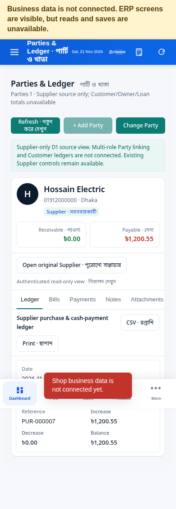
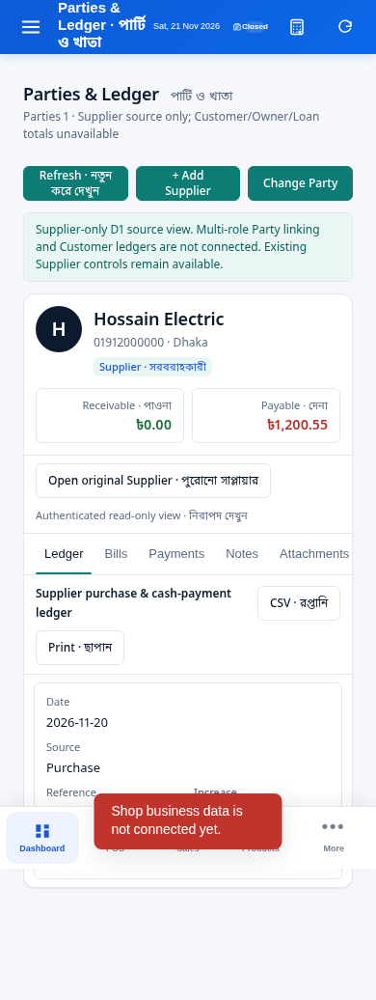
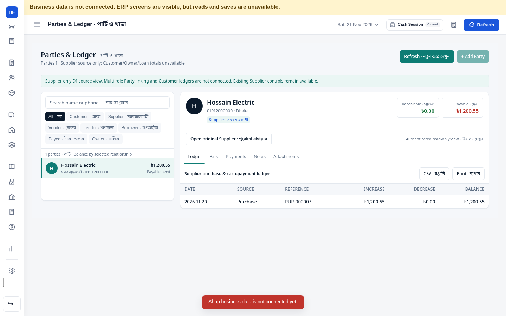
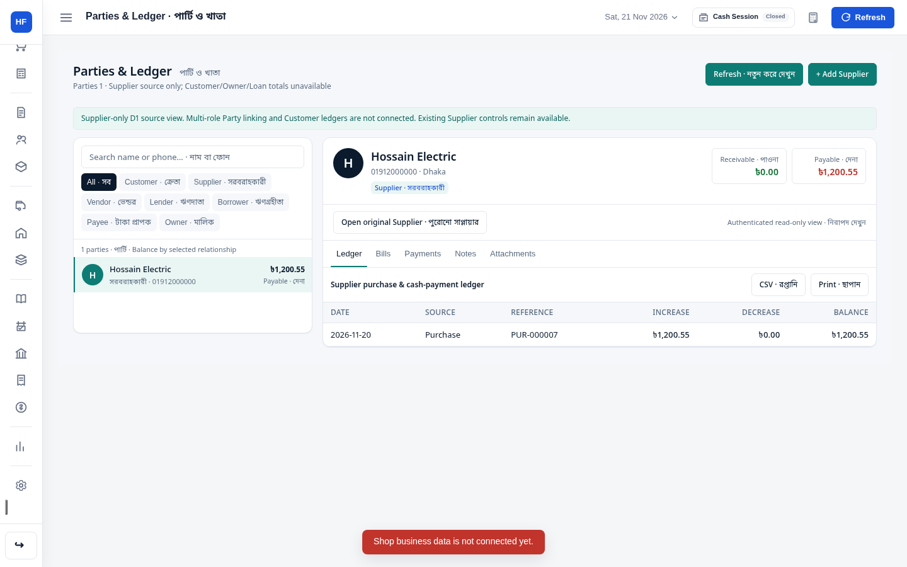

# M01 HisabIQ Party — visual evidence and source-only Supplier create

**Review date:** 21 November 2026. **Base SHA:** f26d0e0e98f0b17be4385dbdb68d784fda4c06e0. **Visual authority:** hisabiq_ui commit e42a00a9f48ffc1f5c4ec10083e36d9eb4686484 and docs/design-system/HISABIQ_SHERERP.md. **Surface:** compiled authenticated Owner ERP Party page, synthetic HTTP fixture from qa/m01-hisabiq-party-browser.spec.mjs. This is real Chromium rendering of the built page, NOT a live Cloudflare Shop D1 transaction check.

## Before / after screenshot comparison

| State | Before | After |
| --- | --- | --- |
| Phone 390 px |  |  |
| Desktop 1440 px |  |  |

Additional verified captures: [320 px](images/320-after.png), [768 px tablet](images/768-after.png), [1024 px desktop split](images/1024-after.png), [390 px dark mode](images/390-dark-after.png), [390 px Add Supplier bottom sheet](images/390-add-supplier-after.png), [1440 px Add Supplier dialog](images/1440-add-supplier-after.png).

## Visual analysis, fixes and residual gaps

1. **Contradictory global warning:** Before, a yellow banner declared that all ERP business reads/saves were unavailable, even while the source-backed Party displayed a Supplier ledger from the authenticated API. After, CSS hides only that global banner while the Party page is visible. The truthful Supplier-only capability and missing role-ledger notice remains. Other screens keep the original warning.
2. **Dead Party affordance:** Before, the primary Add Party action was permanently disabled, although a restricted existing Supplier create endpoint already existed. After, the source-only view clearly labels the button **Add Supplier** and opens a real restricted Supplier form. A future generic unified Party view still disables Add Party because its backend is absent. Neither view invents Customer/Lender debt.
3. **Responsive details:** Confirmed 340/380 px desktop directory, tablet right picker, phone bottom picker, 36 px input/button geometry, 12 px overlay panel, 2 px 200 ms tab underline and proportional money numerals. New Supplier input/dialog uses the same surface tokens, 180 ms entrance and reduced-motion fallback. Stable modal screenshots were retaken **after** the opening animation; the initial transitional opacity capture was discarded.
4. **Dark gutters:** The first dark screenshot showed light empty margins around the Ink Party surface. A browser test demonstrated #content was transparent (RED); a Party-only dark surface selector corrected this (GREEN), and the dark screenshot was recaptured.
5. **Known non-Party visual limitation:** The original Dashboard can leave a red toast saying a separate Shop business service is not connected during navigation. It is not suppressed because hiding actual upstream errors would be misleading. The legacy blue shell remains unchanged per migration rules; a full source-authorized dark shell conversion is outside this M01 slice.

## TDD / QA evidence

- RED: source Supplier-create payload function missing, observed module export error before implementation.
- RED: dark-theme content gutter computed transparent instead of rgb(11, 26, 44).
- GREEN: focused Node contract + HisabIQ design-system tests **15/15**.
- GREEN: Chromium Party workflow + five responsive widths + 401/403 + 503 same-intent retry + multi-role account isolation **13/13**.
- GREEN: original Owner ERP Chromium regression **7/7**. Screenshots rendered by Playwright using compiled Owner HTML and fixture API.
- Unit tests do not certify production D1. No stock, Cash Session, customer balances, loan balances, writes to production or remote D1 were attempted.
- Exact /ui-refine-skill is not available in the connected skill catalog: **skill-specific gate unverified**. Fallback used installed Impeccable visual-review guidance, screenshot inspection, the approved source guide and Playwright manual comparison.
- Final required GitHub CI check statuses must be verified at the exact PR head before merge. Do not merge as full seven-role accounting parity.

## Next integration gate

M03 exclusive backend owner: authenticated Shop-scoped Party list/create/edit/role attachment, existing-identity association (no auto merge by phone/name), per-role gross account ledgers, historical payable/advance/loan opening corrections, and exactly-once D1 posting/reversal tests. M08 validates opening and independent role balances; M01 then completes fully connected seven-role Party UI, native source statement export/print and owner-approved retirement of superseded **legacy UI only**. Keep all historical source IDs, financial records and audit data.
