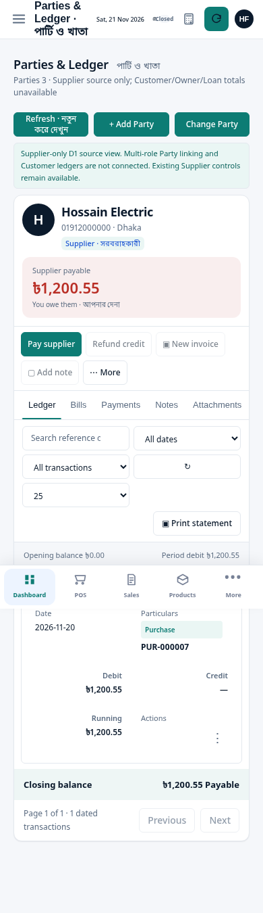
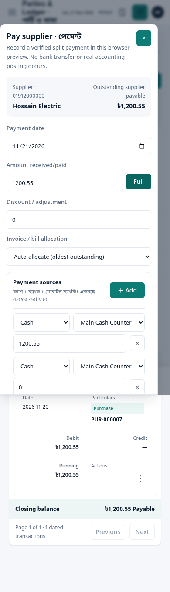
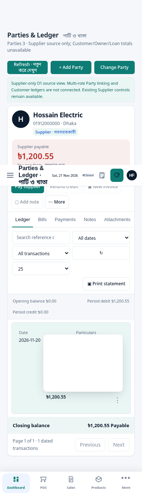
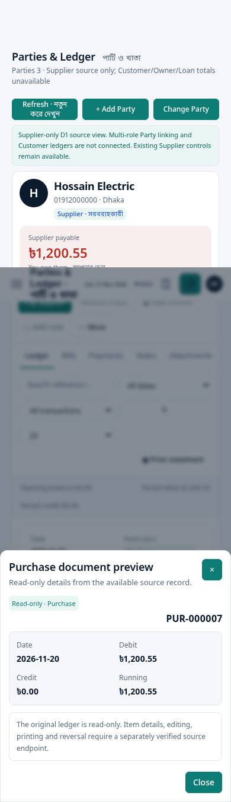
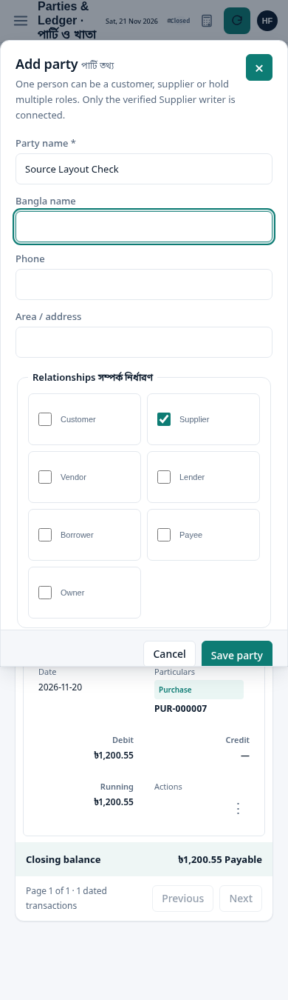
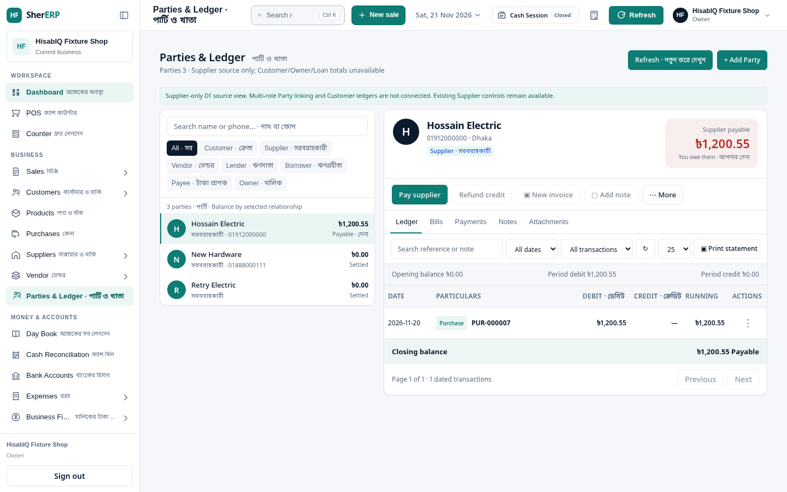
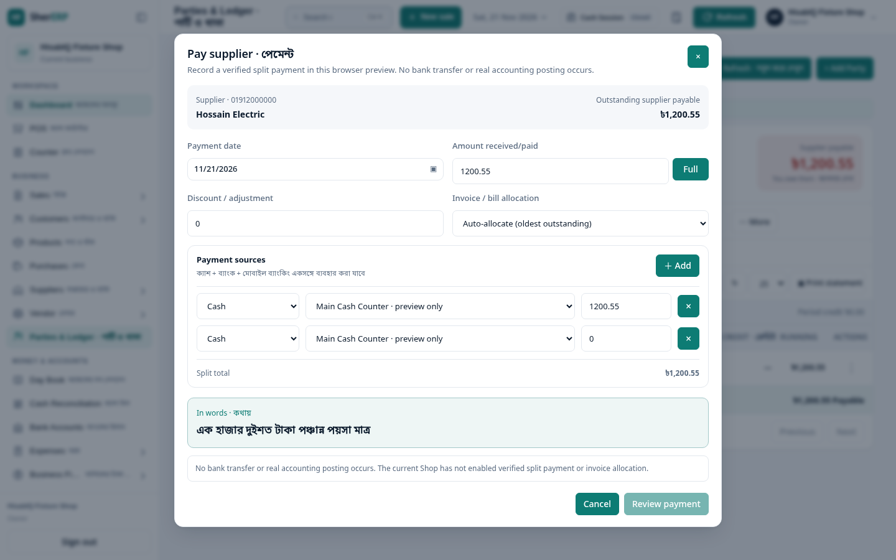
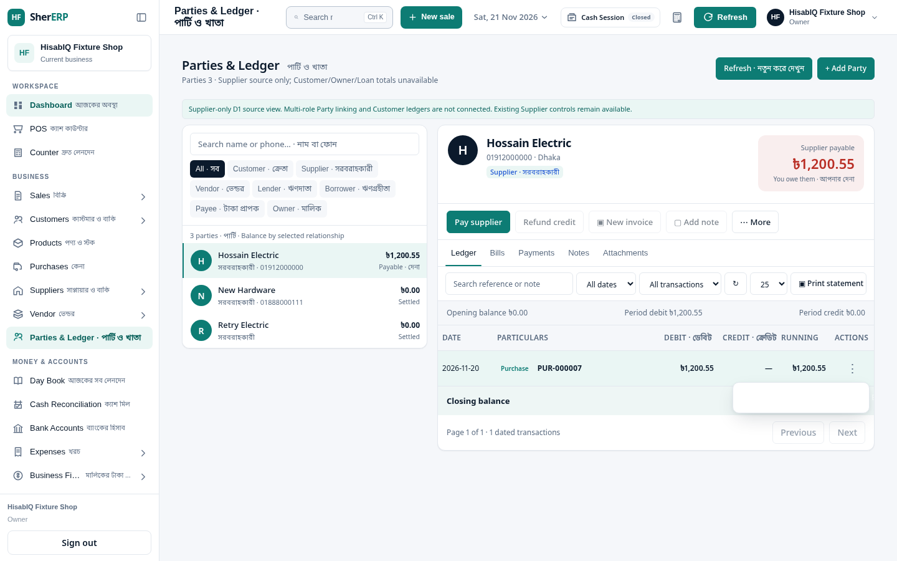
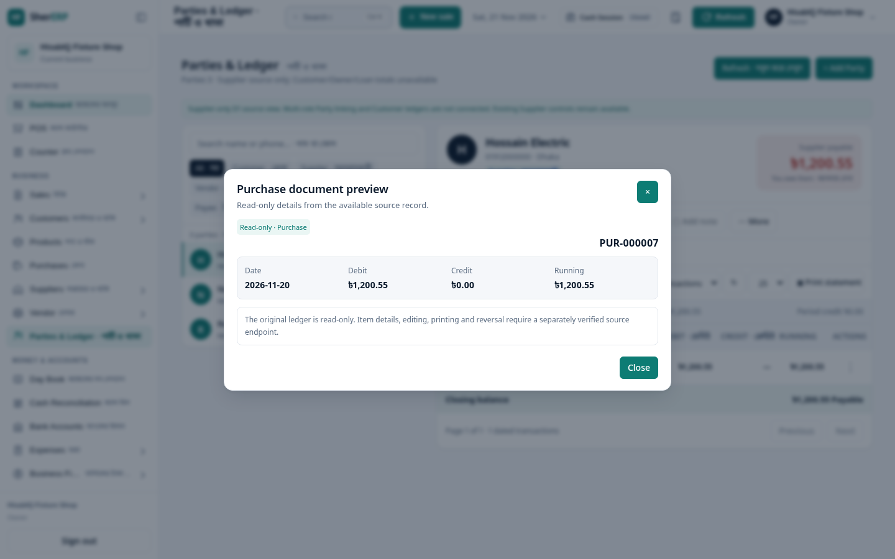
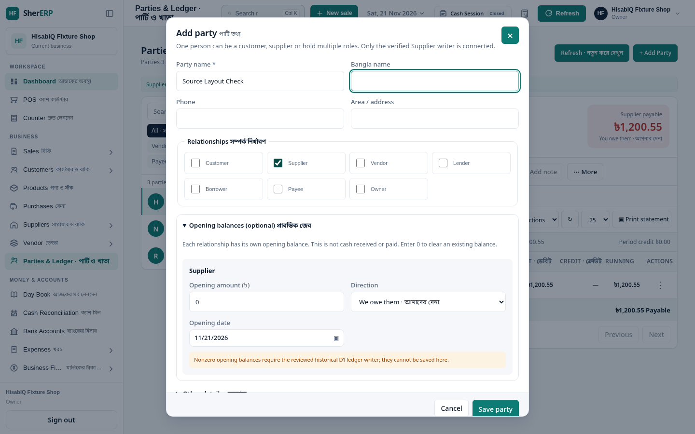

# M01 Party — annotated HisabIQ design parity and safeguarded D1 sources

**Date:** 21 November 2026. **GitHub main at branch creation:** `090c5a4b00f240628c96cbbf319361d26bd24cfd`. **Exact original visual/interaction source:** `shuvodelux-commits/hisabiq_ui@e42a00a9f48ffc1f5c4ec10083e36d9eb4686484`, particularly `src/pages/Parties.tsx`, `src/components/parties/PartyDirectoryResponsive.tsx`, `PartyDetailAdaptive.tsx`, `PartyPaymentDialog.tsx`, `PartyEditorDialog.tsx`, `PartyLedgerRowActions.tsx` and `PartySourceQuickPreview.tsx`. **Visual requirement:** user's five red-number-annotated screenshots from this chat; tracked point by point below.

This is the **authenticated SherERP Owner HTML+JS Party workspace**, not a React rewrite and not a production finance-API launch. All Party CSS is scoped to `#page-hisabiqParties`, uses the existing HisabIQ tokens, Geist + Hind Siliguri, proportionally spaced money values, compact 36px buttons, responsive viewport behaviors, and reduced motion.

## Screenshot annotation checklist and implemented UI

| User screenshot / annotations | Implemented controls | Current authoritative behavior |
|---|---|---|
| **1: Party directory + ledger** — ① More, ② Receive payment, ③ row actions, ④ note row, ⑤ Debit, ⑥ Credit | Separate Party directory, account card, top action bar, 5 underlined tabs, source-ledger search/date/type/page selectors, period debit/credit, running balances, contextual row menu, 25/50 page size | Supplier amounts/entry references come from authenticated existing D1 source. Preview-only payments/notes and unsupported Customer/Owner ledgers remain unavailable. No cross-role netting |
| **2: Payment modal** — ① Add source, ② invoice/bill allocation, ③ Full amount, ④ in Bangla words | Source-matched Payment modal with Cash/Bank/Mobile source selector, dynamic add/remove rows, allocation of **verified Supplier Purchase IDs only**, Full shortcut, amount summary and Bengali words | **No payment POST**: explicit preview label; Review payment disabled until permission-checked transactional D1 API exists. No fake bank transfer or cash movement |
| **3: Allocation dropdown** — ① list of invoices | Native accessible dropdown with auto-allocation label and independently verified Supplier Purchase references where available | Never show hisabiq_ui demo invoice IDs as real. Customer invoice allocation requires a separate authenticated read endpoint |
| **4: Invoice source quick preview** | Read-only source document card with verified reference, date, debit, credit, running balance; open from row Actions → View | Supplier Purchase source is available; itemized Sales invoice detail not invented. Edit, print per source, delete/reverse disabled until authorized audited source operation |
| **5: Add Party modal** — ① name, ② phone, ③ address, ④ Bangla name, ⑤ 7 role checkboxes, ⑥ per-role opening section, ⑦ amount direction | Two-column form on desktop, one-column mobile bottom sheet; role checkbox grid, opening amount/direction/date, dynamically labeled relationship and explicit unconnected role-opening explanatory cards | **Only** current authenticated Supplier zero-opening D1 create is enabled (same idempotent operationId). Multi-role, Customer create, nonzero opening or unsupported Bangla-name field block Save, not a false success |

### Screenshot evidence from actual compiled Owner fixture

The screenshots below were captured by **Playwright Chromium** against the compiled GitHub Owner app and a synthetic authenticated Shop fixture. They are not screenshots of the hosted Cloudflare environment, which requires separate release.

| Responsive width | Directory and ledger | Payment-source modal | Source row action | Source preview | Add Party editor |
|---|---|---|---|---|---|
| 390px |  |  |  |  |  |
| 1440px |  |  |  |  |  |

**Visual-review corrections performed:** fixed 7px desktop table overflow caused by the Actions header; constrained the six-column ledger and toolbar to the actual content width beside SherERP sidebar; fixed narrow 390px payment source grid and Add control wrapping; eliminated the misleading rook icon for Remove source; kept fixed bottom modal footer and reduced checkbox height. On desktop, the existing Owner touch-date enhancer intentionally proxies native date inputs; QA accepts the visible proxy instead of testing the hidden native input. Source demo numbers and fixtures from the user screenshots are **not added as business data**.

## Superpowers TDD and verification

- **TDD RED before code:** 4/4 initial reference contract assertions failed; separate Bengali amount-words test also failed.
- **GREEN:** 5/5 annotated source-locked contract tests; **20/20** combined Party/design/annotated contracts.
- **GREEN:** 21/21 authenticated fixture Playwright Chromium Party tests including 320, 390, 768, 1024, 1440 breakpoints, source gross Supplier advance vs payable, multi-role synthetic independent accounts, 401 denied behavior, Full and add/remove payment source, verified allocation, source menu/preview, note action disabled, editor validation, 403 denial, uncertain save retry and zero unsupported financial POST.
- **GREEN:** 7/7 existing original Owner Supplier/Purchase/auth Chromium regressions.
- **GREEN:** 1/1 two-Shop **real local Workerd/D1** browser acceptance: verified authenticated Supplier create in Shop A, exact ID/readback and reload, immutable operation replay, unauthorized Shop B access denial and zero nonzero-opening rejection. It used a disposable D1 fixture; not hosted.
- Full source verifier, docs checker, syntax, diff and CI status are checked separately prior to merging; the PR must not claim hosted acceptance.

## Legacy Customer/Supplier retirement gate — expressly not removed by this PR

The approved ADR-007/008 require **real authenticated unified Party identity and all independent role accounts** before removing original Customer, Supplier, Vendor or Finance/ledger screens. Current Shop D1 has a Supplier writer and Supplier source ledger, but no verified `POST /api/owner/parties`, Customer source reconciliation, seven-role opening writer, split receipt cash/bank allocation, full source ID linking, edit/reverse/delete audit, or legacy mutation parity. Removing their underlying workflows now would strand original sales, purchases, due balances and financial history. This PR **does not delete or hide** original Customer/Supplier screens or records; it makes Party the visually preferred combined directory and retains deep links to the original workflows in More until an independent M03+M08 cutover passes actual two-Shop D1, migration backup/restore, permissions and M10/M11 release checks.

**Super Board UI skill:** source repo exposes `.claude/skills/super-board` as a symlink to `../../vendor/super-board/skills/super-board`, which is not present in the checked-out public repo tree, and no runnable launcher was available in this environment. **The named skill was not invoked.** Its verification requirement was addressed with Superpowers TDD, pinned-source component inspection, real Playwright screenshot review and real local Workerd/D1, with this limitation documented.

**Rollback:** revert this scoped Party CSS/JS/test PR; original UI handlers and D1 source data are preserved. No production database, migration, Worker deployment, or financial POST was made here.
