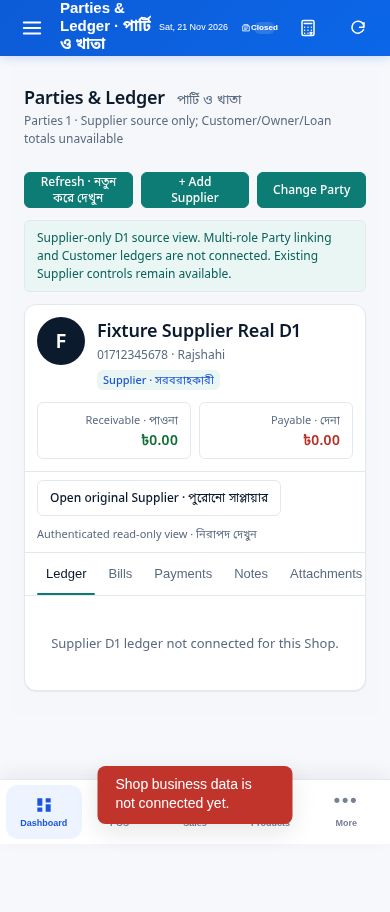
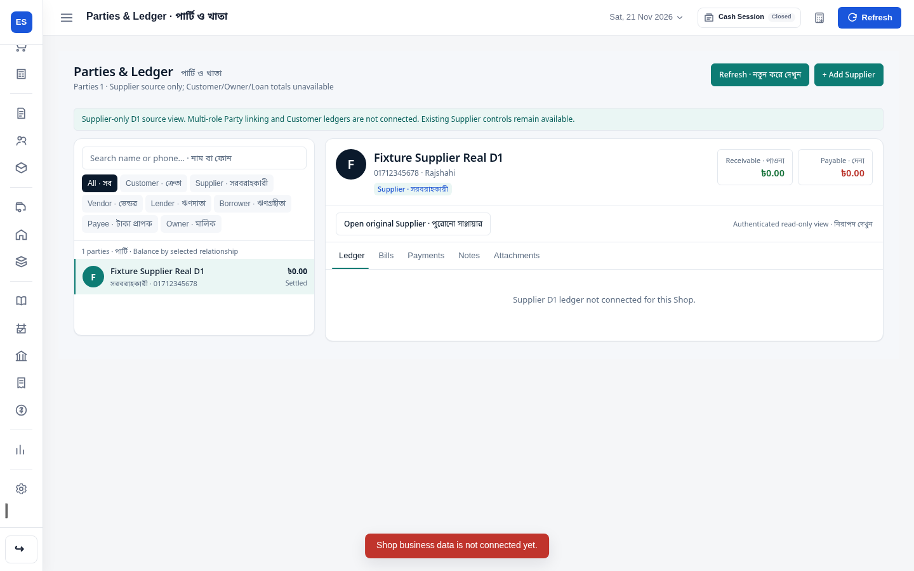

# M01 Party Supplier — real local Workerd/D1 browser acceptance

**Date:** 21 November 2026. **Parent:** PR #854, source UI pinned at `hisabiq_ui@e42a00a9f48ffc1f5c4ec10083e36d9eb4686484`. **Purpose:** prove the actual compiled Owner Party screen can submit the reviewed Supplier-only payload to the already-existing private Worker and persist it in an isolated Shop D1.

## Evidence and test setup

Run from the repository root after installing test dependencies and Chromium:

```bash
node --test qa/m01-party-supplier-real-d1-browser.spec.mjs
```

This one test starts `startCleanShopHarness()` and two **disposable local Workerd D1** databases, applies the existing reviewed Party and Supplier master migrations, compiles the Owner ERP, and serves the HTML to Playwright Chromium through a local HTTP bridge. The bridge maps private Owner API requests to the real `src/m03-owner-redemption-worker.js` Hono router at its required HTTPS origin and injects a **test-only authenticated Owner session** issued by the existing fixture. It does not use or expose live cookies, credentials, Cloudflare accounts or production data.

The test verifies in one browser-to-D1 cycle:

1. Source-only Party shows the **existing** Add Supplier capability, not a fake seven-role Create Party endpoint.
2. The mobile 390px form saves one Supplier with exact `openingBalance: '0'`, then the Shop D1 master records the original `SUP-000001` ID and zero due.
3. The saved Supplier is fetched from the authenticated Worker and shown in the actual Party directory/profile on mobile and desktop; browser reload preserves that result from D1.
4. Same operation ID and identical POST replay returns 200 without duplication; the same ID with altered data is rejected 409.
5. A Shop B token is denied both GET and POST against Shop A, while Shop B independently creates its own Supplier with the same display name and its own `SUP-000001`.
6. A negative nonzero historical opening balance returns 400 and cannot create a second Shop A Supplier.
7. The mobile 390px and desktop 1440px rendered screens are captured and inspected.

## Playwright screenshot review

| 390px saved Supplier after real D1 write | 1440px saved Supplier after real D1 reload |
| --- | --- |
|  |  |

**Analysis:** The 390px page fits its 36px actions and role profile within the viewport without horizontal clipping; the 1440px page retains the 380px directory and spacious detail pane. Verified Supplier ID and zero balances are fresh server data, not a browser preview. The original global shell can still display a red disconnected-service toast over the mobile bottom navigation; it is not suppressed because the warning refers to other unconnected ERP modules. The profile correctly reports that the **Supplier transaction ledger is not connected** on this minimal Shop fixture, rather than inventing historical purchases or payments. The UI snapshot comparison and before/after style refinements for the parent UI change are in PR #854 `docs/reviews/m01-hisabiq-party-ui/README.md`.

## Boundaries and release decision

**Pass of this test is not a hosted deployment GO.** It does **not** verify real Google OAuth in a browser, production Cloudflare Worker routing, full seven-role Party records, Customer Due, historical Supplier/Loan openings, cash postings, purchase/return FIFO, full ledgers or native D1 backup/recovery. Those remain M03/M08/M10/M11 release gates. The HTTP bridge explicitly adds the **fixture Owner cookie** because the browser test runs on localhost; production Owner auth is exercised independently elsewhere. The test does exercise the existing Owner session validation and Shop-scoped SQL write-grant checks in the real Workerd/D1 path.

**Do not remove legacy Customer, Supplier or finance UI/ledger modules** until all replacement workflows, old source ID links, historical opening balances and role-separated statements are reconciled against real authorized Shop D1 and approved for cutover. Never delete historical transaction records. The exact `/ui-refine-skill` is not installed in this environment; it was not invoked or claimed. The approved screenshot-inspection fallback was used and the skill-specific gate remains unverified.
