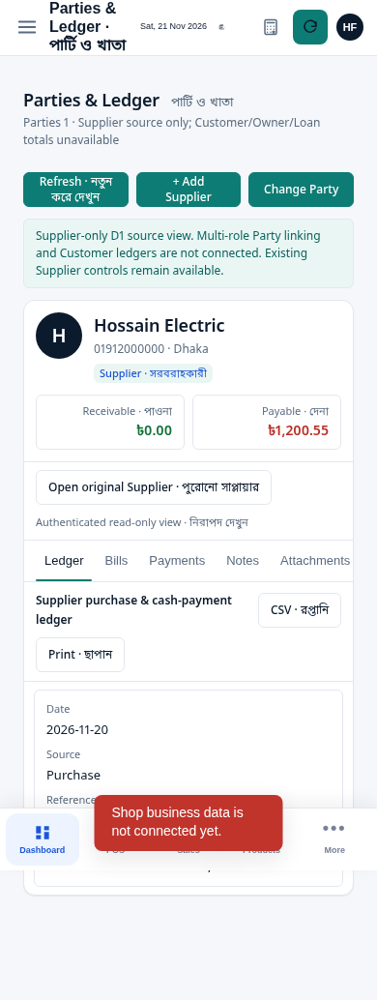
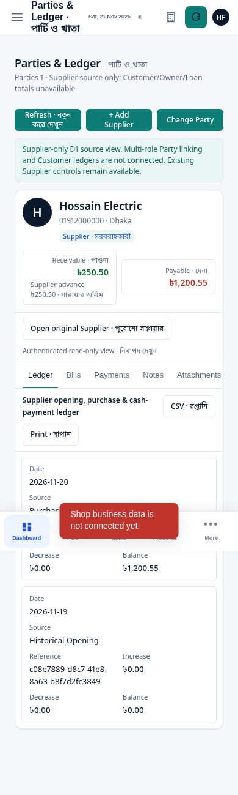
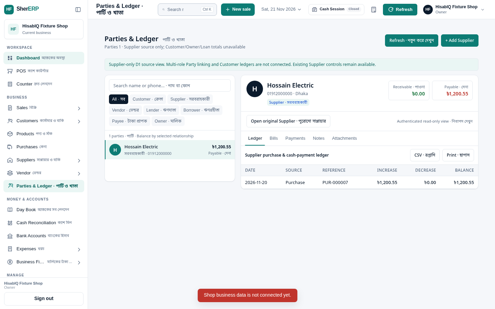
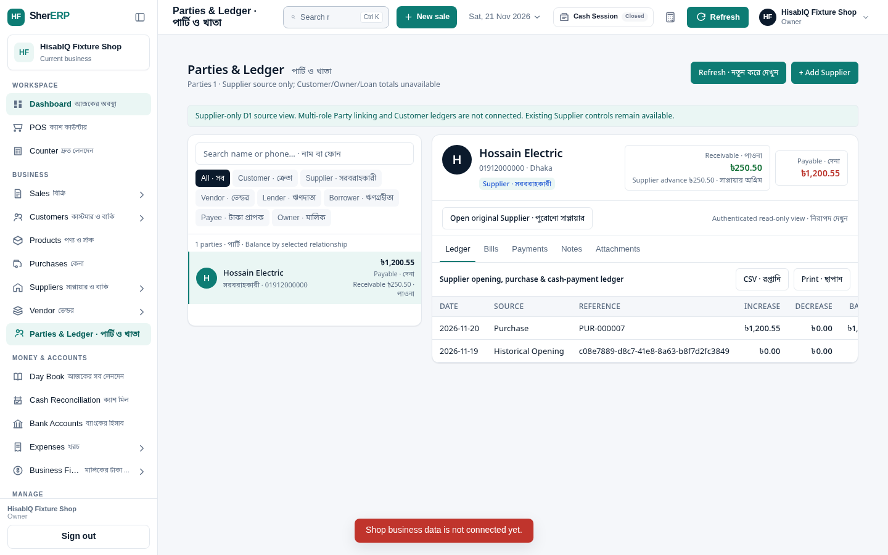

# M01 HisabIQ Party — separate Supplier historical advance and payable

**Review:** 21 November 2026. **Source UI reference:** `hisabiq_ui@e42a00a9f48ffc1f5c4ec10083e36d9eb4686484`. **SherERP baseline:** `main@9670c5e2947a35a5e7d31c84c2aea36af1b83a46`. **Backend dependency:** independent PR #862 signed historical Supplier checkpoint. These screenshots are from the compiled Owner app served through a **synthetic authenticated local HTTP fixture**, not a production Shop D1 or deployed backend claim.

## Before/after responsive browser evidence

| Width | Before (current merged Party screen, zero opening fixture) | After (proposed signed-opening contract fixture with Supplier advance and positive due) |
| --- | --- | --- |
| 390px phone |  |  |
| 1440px desktop |  |  |

The **before** images are actual Playwright captures of the **same compiled Owner shell** with the pre-0013 Supplier response (no new opening checkpoint fields). The **after** images are captures of that exact build with the proposed optional signed opening fields and a source history entry. Both screenshot states are recorded by `qa/m01-hisabiq-party-browser.spec.mjs` with fixed viewport widths. This eliminates misleading differences from the separately merged HisabIQ sidebar redesign. The older PR #854 Party screenshots are retained at `docs/reviews/m01-hisabiq-party-ui/` as historical source implementation evidence, but are **not** the before images used here.

## Screenshot review findings and fixes

1. **Account truth:** A Supplier with authenticated current due **৳1,200.55** and separate historical Supplier Advance **৳250.50** must show both amounts. **Do not subtract the advance from payable,** double-count the positive opening in current due, or insert imaginary opening cash flow. The detail cards show receivable and payable separately and identify the historically sourced Supplier advance.
2. **Directory omission found during visual inspection:** A single-role Supplier with both positive payable and advance initially displayed **only Payable** in the directory, although profile detail showed both. Updated compact directory to show the payable and separately labeled receivable without turning the two into one net value.
3. **Ledger source:** Verified `Historical Opening` uses the exact original operation UUID rather than a fabricated `PUR-` or `SPY-` reference. Negative historical advance is a gross asset checkpoint, not a false `Supplier Payment` credit in the payable ledger.
4. **Responsive:** Actual compiled Owner shell and Party source tested at **320/390/768/1024/1440px**. Maintain 36px controls, original theme, source underline tabs, and proportional currency fonts. Desktop directory may expand row height when two gross positions need labels. Phone uses the existing stacked ledger cards; no new modal, payment action, or screen added.
5. **Known existing unrelated shell toast:** In the synthetic fixture, the global Owner Dashboard still shows `Shop business data is not connected yet.` even when the Party source service is simulated as connected. This upstream toast is not suppressed; doing so would hide actual errors in other ERP modules. It is outside M01 Party scope and not evidence that all Owner APIs are live.
6. **Skill-specific gate:** Exact `/ui-refine-skill` launcher is unavailable in this ChatGPT/connected machine session. The skill was not invoked or claimed. Fallback uses the pinned HisabIQ design-system source, Refero/Impeccable product-interface guidance, and explicitly inspected Playwright before/after screenshots; skill-specific gate remains **unverified**.

## Validation and limitations

- TDD RED: **7/8 new source-opening contract assertions failed** before changing the Party frontend; 1 existing behavior passed.
- TDD GREEN: **23/23** Party/HisabIQ design contract tests after implementing strict source-only read projection and malformed-record rejection.
- **25/25 Chromium browser tests passed**, including five new source-opening/advance viewport checks at 320, 390, 768, 1024 and 1440px and all existing Owner Supplier, Purchase and session regressions. Full-page 390px/1440px after screenshots were re-captured and manually inspected after refining the directory; no visible horizontal overflow.
- **23/23 M01 Party/HisabIQ contract tests passed** with optional legacy-response compatibility and strict source-ledger opening UUID acceptance.
- `npm run verify:source`: **84/84** frozen source files verified; `npm run docs:check`: passed; JS syntax and `git diff --check`: clean. These are local tests on the connected CachyOS browser and synthetic data, **not hosted Workerd/D1 opening acceptance**.
- `src/ui/hisabiq/party-workspace.mjs` remains the only production UI file modified. Existing historic Customer/Supplier/Vendor/Finance screens, ledger data and cross-role controls are untouched; **no new POST route or operation for historical opening is enabled here**.
- Backend PR #862 is unmerged at screenshot capture time and is a **separately gated operational D1 schema/Worker proposal**. This UI slice is backward compatible with pre-0013 Shop responses but does not itself prove signed historical opening can be written to hosted production.
- Real authenticated two-Shop Workerd/D1 financial reconciliation, complete gross Customer/Lender/Borrower role ledgers, nonzero opening availability in the hosted Worker, M10 restore and M11 independent release signoff remain blocked until their owners complete them. **Legacy ledger UI must not be removed** before verified replacement.
