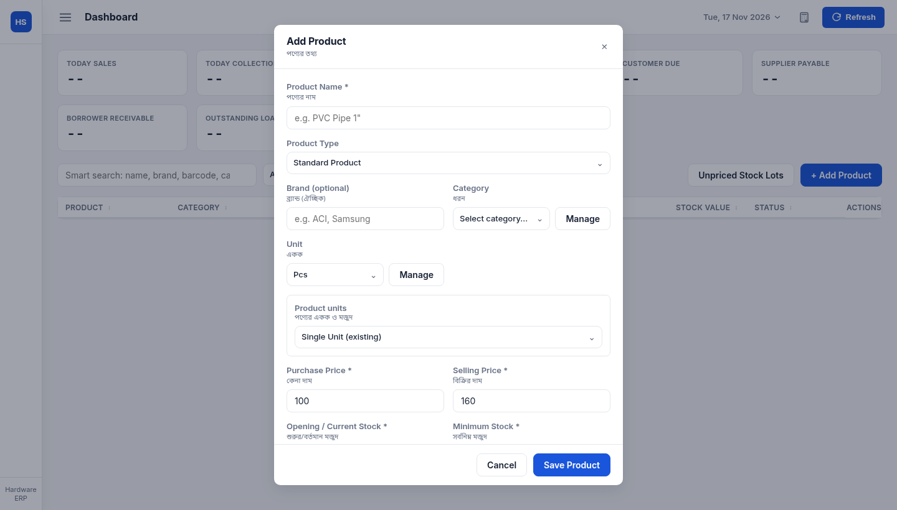
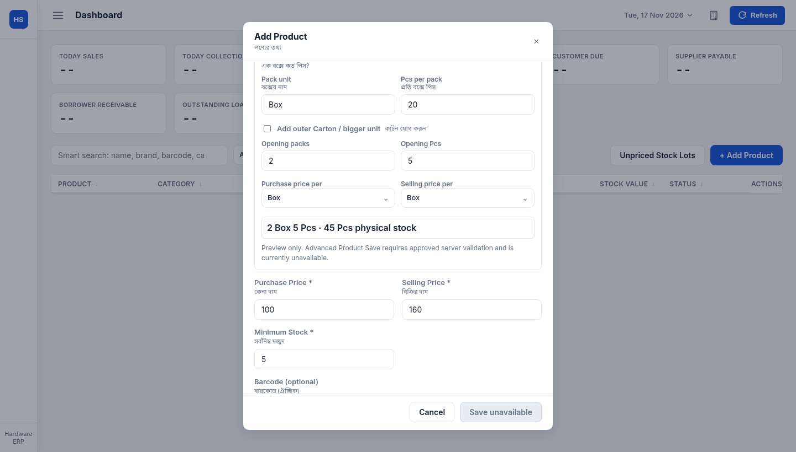
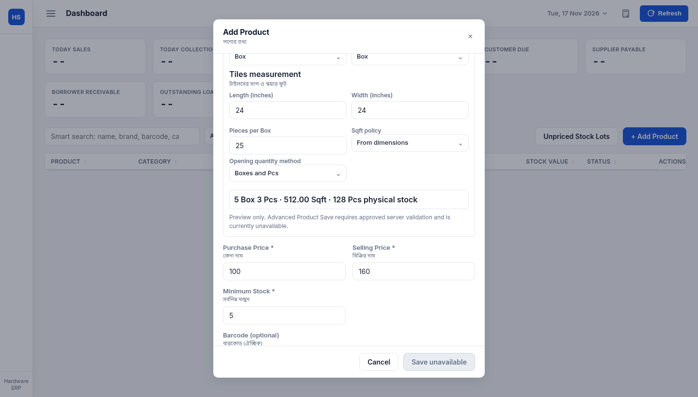
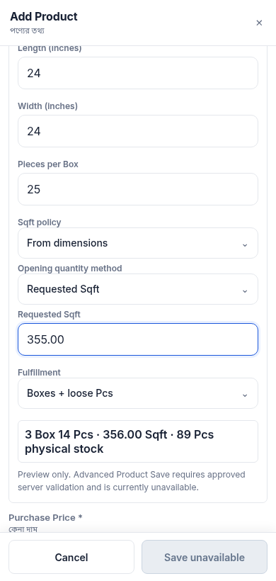
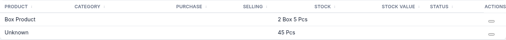

# M01 Products UI — bounded visual refinement evidence

**Work:** [PR #581](https://github.com/shuvodelux-commits/SherERP_Cloud/pull/581) · [issue #564](https://github.com/shuvodelux-commits/SherERP_Cloud/issues/564) · **Date:** 2026-11-17.
**Surface:** existing original Add Product modal and Products stock table, extended through a compiled-only UI layer. All images were actually captured by headless Chromium at 1440×820 desktop or 390×820 mobile on a **synthetic unauthenticated UI fixture**. No business/customer data, production D1 or product posting was used.

| Reference: existing Single Unit form | After: Multi-unit 2 Box 5 Pcs |
| --- | --- |
|  |  |

| After: Tiles 24×24, 5 Box 3 Pcs | After: mobile requested 355 Sqft gives actual 356 Sqft |
| --- | --- |
|  |  |

**Table verification:** 

## Bounded manual critique and refinement

- **Round 0 (P1, corrected):** the disabled advanced **Save Product** button was still bright blue and appeared actionable. A test-first browser regression forced a visibly grey **Save unavailable** button, while Single Unit and Bundle retained original Save behavior. The new button correctly communicates the current M03/M04 source-write gate.
- **Round 1 (P1, corrected):** the old editable single-quantity **Opening / Current Stock** field remained beneath the split Box/Pcs editor, creating duplicate-entry ambiguity. A browser regression now requires that field to be hidden only for advanced modes and restored for Single Unit; Bundle retains its source behavior.
- **Table (P1 evidence):** trusted source-specific M05 metadata displays **2 Box 5 Pcs** from 45 canonical Pcs. An ordinary product lacking approved conversion metadata remains **45 Pcs**, with no guessed ratios or fake area. The table example is a synthetic fixture and is not evidence of a live D1 Products API.
- **Area fidelity:** 24×24-inch Tiles, 25 Pcs/Box, 5 Box+3 Pcs → **512.00 Sqft**. A request for **355.00 Sqft** rounds up to 89 Pcs / **356.00 actual Sqft**, not 355.
- **Mobile:** the modal remains one column at 390px; screenshots show labels, full-width inputs, exact Sqft and a sticky Cancel/disabled-Save footer. The Chromium test guards against horizontal overflow.
- **Status:** 5/5 targeted real Chromium tests passed in the authorized QA workspace after both refinements, before final full exact-head GitHub CI. The built-in UI test suite also runs in GitHub Actions on the PR HEAD.

**Manual reviewer score (subjective, screenshot-based, not an automatic Impeccable result):** initial advanced form 15/20 design + 13/20 UX audit = **28/40**; revised 17/20 design + 17/20 UX audit = **34/40** (**better**). Fixed: two P1 issues. Remaining P0 for production *outside this read-only UI*: authorized M03/M04 product writes and source metadata read path. Dark-mode screenshots were not verified; no claim is made.

**Skill limitation:** The requested super-board `/ui-refine-loop` requires a Claude workflow/Impeccable agent setup unavailable on this connected host. This is a **bounded manual review using actual screenshots**, not an invocation of the unattended five-round workflow or an independent multi-agent grade.

**Merge gate:** human review, all current-head GitHub CI, no production stock posting and no unrelated original UI or D1 changes.
