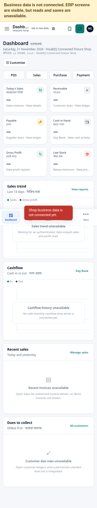
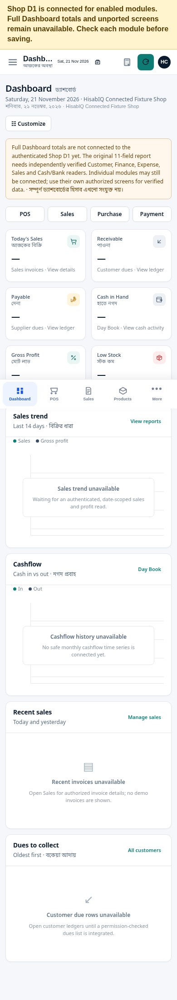
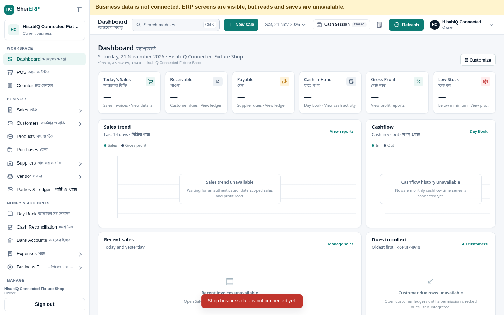
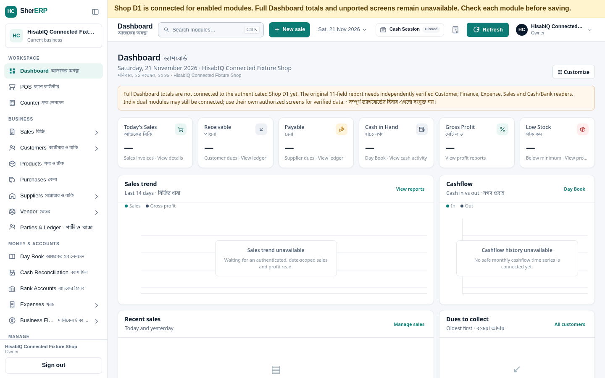

# M09 Owner Dashboard — corrected Shop D1 connection state

**Date:** 21 November 2026, Dhaka. **Source:** `main@b15a262d3c9354c745854e9ac59807e9572bf63d`; HisabIQ original Dashboard appearance/source preserved. **Scope:** compiled-only Dashboard read-failure status and original Owner browser regression, with no new financial RPC or D1 write.

## Why the reported error occurred

The existing source `legacy/source/dashboard.html::dashLoad()` calls `serverCall('getDashboardStats', authToken)` on opening the Dashboard. In `scripts/build-owner-frontend.mjs`, the original authenticated Owner RPC bridge implements Product, Supplier, Purchase, Cash Session, POS/Return and app-shell endpoints, but **does not implement this complete Dashboard source function**. Its deliberate unrecognized-function fallback returns `This ERP action is not available yet.`; original `dashLoad()` shows it as a global red toast. In parallel, the source Owner banner says **all business reads/saves unavailable**. Neither text proves the Shop DB is physically disconnected.

### Live Cloudflare read-only evidence (no database IDs, session tokens or personal data recorded)

The authorized operator's Wrangler OAuth performed **read-only** checks: `d1 list`, `versions list`, `deployments list`, `versions view`, and the existing repo script `scripts/m03-live-owner-readiness.mjs`. The active `shererp` Worker release (version 70 when checked) has actual `CONTROL_DB` and `PLATFORM_PILOT_DB` D1 bindings. Existing D1s `shererp-admin-control-v2` and `shererp-shop-001` must be **reused, not created again**. The configured login, dashboard bootstrap, catalog, Purchase and POS Cash flags are enabled. The strict remote read-only preflight reported:

| Check | Verified result |
| --- | --- |
| Current Owner auth/Shop binding | `authConfigured=true` |
| Exact physical Shop D1 identity | `shopIdentityVerified=true` |
| Original 13 immutable migration receipts and schema seal | `baseline13Verified=true` |
| Reviewed Supplier Cash overlay | `approvedSupplierOverlayVerified=true` |
| Configured clean Shop catalog read | `coreReadConfigured=true` |
| Full production acceptance | **NO-GO** |
| Disabled operational flags | Cash Returns; Supplier Cash Payment |
| Remaining release gates | Private publisher, hosted two-Shop acceptance, M10/M11 restore rehearsal, full original RPC parity and independent financial/security review |

**No remote D1 migration, Worker deployment, flag change, new database, cash/stock/ledger posting, or production session bypass was performed.** The browser's existing Owner session had expired, so this report does **not** claim hosted authenticated UI acceptance.

## Browser before / after, actual compiled Owner frontend

Both screenshot states use the same frozen source Owner UI and synthetic authenticated loopback Shop fixture. The **before** screenshots were taken from an isolated clean `main@b15a262d` worktree, not fabricated by manipulating the resulting UI. The **after** screenshots were generated by the feature branch Playwright tests. These fixtures prove only compiled browser UX—not live Shop D1 readiness.

| Viewport | Before: generic disconnected banner and red unsupported-Dashboard toast | After: correctly bounded connection status |
| --- | --- | --- |
| 390px mobile |  |  |
| 1440px desktop |  |  |

### Visual inspection results

1. **Root cause:** red global toast `This ERP action is not available yet.` is issued by missing `getDashboardStats` RPC adapter, not by failed D1 identity check. Now suppressed *only* for that exact known missing Summary RPC in the compiled **Owner** Dashboard. Other unexpected errors continue to the global toast; the original source and inert public Worker do not change.
2. **Misleading original banner found on first after screenshot:** yellow banner said `Business data is not connected. ERP screens are visible, but reads and saves are unavailable.` after a current authenticated Owner session. Updated it *only if its exact untouched default is still present* to `Shop D1 is connected for enabled modules. Full Dashboard totals and unported screens remain unavailable. Check each module before saving.` Existing more specific module/status banners are never overridden.
3. **Truthful status:** a scoped, inline bilingual status explains why the original eleven-field Dashboard totals need new validated Customer, Finance, Sales, Expense and Cash/Bank readers. The cards remain `—`; no misleading zeros or made-up financial chart values.
4. **Responsive:** Playwright checked 320/390 mobile, 768 tablet, 1024 desktop and 1440 wide desktop. Final screenshots examined at 390 and 1440. No horizontal overflow; inherited HisabIQ control, typography and palette preserved. The inline message is compact at desktop and wraps safely on small devices. No new modal or inactive controls.
5. **Security/data preservation:** a rejected/expired Owner session does not reveal Dashboard state; no financial POST or public RPC was made. Existing Product, Purchase, Supplier, Party and Owner navigation/auth browser checks were retained and passed.
6. **Design skill availability:** exact `/ui-refine-skill` was not installed on the connected device; it was **not** invoked or claimed. Per AGENTS.md fallback, the pinned HisabIQ source tokens, Playwright screenshots and manual visual inspection/refinement were used. The skill-specific gate remains **unverified**.

## Test-first and verification

- **Initial TDD RED:** 2/3 source status assertions failed on current main; then combined new/existing Dashboard contract suite **12/12 GREEN**.
- **Follow-up screenshot issue TDD RED:** 1/3 new precise banner tests failed with the earlier global banner; corrected compiled-only patch, returning **12/12 GREEN**.
- **Wider Dashboard source-model suite:** **100/100 GREEN** using `npm ci --ignore-scripts --no-audit --no-fund` in isolated worktree with pinned lockfile. The first attempt was 94/100 due to missing `@noble/hashes` in the user's older shared `node_modules` symlink; fixed **test environment**, not business code.
- **Chromium full affected Owner/Party/bug matrix:** **32/32** including original Owner authentication, Supplier and Purchase browser regressions, rejected financial POST, five new viewports, read-failure note and unrelated-error visibility.
- Original legacy `Dashboard.gs` and `dashboard.html` unchanged; all original Dashboard KPI DOM IDs and unsupported RPC fail-closed branch preserved.
- `npm run verify:source` passed for **84/84** frozen files, `npm run docs:check` passed, JS syntax and `git diff --check` clean. A focused exact-head Chromium workflow was prepared but **could not be pushed** because the connected GitHub OAuth scope lacks permission to modify `.github/workflows`; it was removed from this PR to preserve least privilege. Existing project GitHub CI still applies; this additional seven-case Chromium suite was run locally only and is documented here. Required existing GitHub CI must finish before merge.

## Next engineering task (not falsely claimed complete)

Implement a separately reviewed *complete*, permission-checked eleven-field Dashboard read from actual Shop D1, including original source date/time/currency, gross Customer/Supplier/Finance account directions, Cash Session Cash Book, Sales/Returns, Expense, Purchases and low-stock counts, with real D1 and cross-tenant denial tests. M03 alone owns Worker binding, authorizing D1 reads and schema; M09 may supply source-faithful data projections but must not publish a financial route on its own. Once the complete endpoint is backed and source-reconciled, the original `dashLoad` success path automatically hides the inline warning; avoid inventing partial totals.

**Rollback:** revert this compile-only UI PR. Neither live databases nor historical Party/finance ledgers require changes. Do not retire legacy screens based on this UI fix.

## 21 November — compiled Owner Dashboard fallback compatibility / CI fix

The generic Owner frontend unsupported-RPC fallback uses
`This ERP action is not available yet.`, but the Dashboard overlay and
its contract still matched the superseded message. As a result, the
real compiled Dashboard did not show its contextual readiness note and
the baseline M09 contract failed in unrelated pull requests. The minimal
correction matches the **current** generic rejection only inside the
existing `getDashboardStats` catch branch. Other unsupported RPCs still
reject, unrecognized errors remain visible, source files and all
financial data remain unchanged. Playwright before/after screenshots at
390px/1440px show the scoped status replacing the misleading generic
banner, without changing the original Dashboard layout. The exact
`/ui-refine-skill` launcher was unavailable; real-browser visual
comparison and source-aligned functional checks were used instead.
