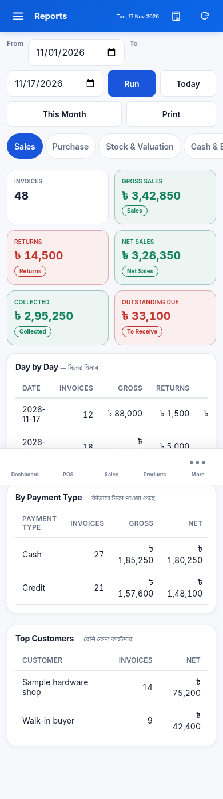
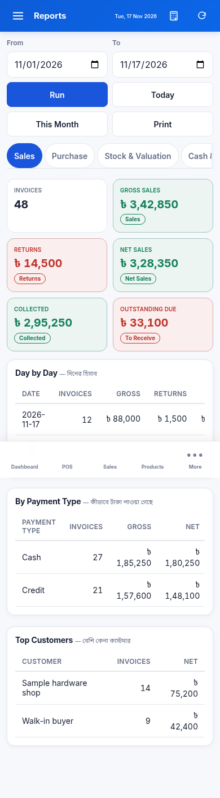
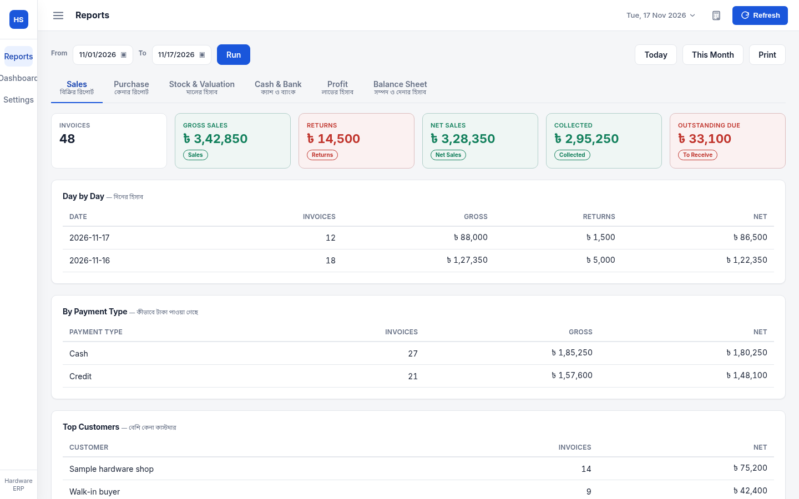
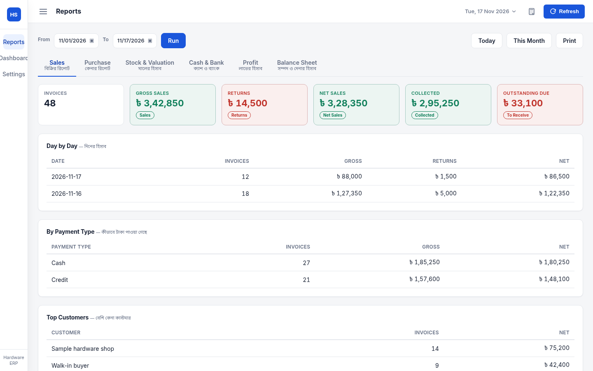

# M09 Reports — UI refine-loop screenshot evidence (synthetic only)

**Source:** `SherERP_Cloud@59b0e2e4b7184acf2f3645aca32da1cb1c6d5cb3` compiled via `npm run build:frontend`. **Scope:** Reports page, original HTML/CSS/JS preserved. **Owners:** M09 owns this report/QA evidence; M01 owns production UI integration; M03 owns shared Worker/RPC. **No live financial report activation**.

## Playwright screenshots — original vs CSS-only proposal

| 390px mobile — baseline | 390px mobile — proposed |
| --- | --- |
|  |  |

| 1440px desktop — baseline | 1440px desktop — proposed |
| --- | --- |
|  |  |

All amounts, buyers, report rows, shop names, and dates shown here are **synthetic testing fixtures**, not actual business information. The script reveals the existing Reports DOM in a **local-only test browser** because public authenticated report RPCs are deliberately unavailable. It does not log in, query a tenant, call D1 or alter the Worker.

## Findings / grades

| ID | Severity | Baseline finding | Proposal status |
| --- | --- | --- | --- |
| UI-1 | P1 | At 390px, From input starts y=68 and To input starts y=122; visual labels are detached from their fields | **Fixed in preview:** both date inputs start y=91, each 179px wide; Run/Today align on y=145 |
| UI-2 | P2 | Only first few of six horizontally scrollable report tabs are visible; swipe affordance weak | **Partial:** 3px right-edge affordance and preserved horizontal scrolling; accessible hint still needs M01 HTML approval |
| UI-3 | P2 | Sales Day-by-Day table can extend horizontally beyond viewport on mobile without explicit scroll cue | **Not fixed:** preserve table data/scroll behavior; M01 should add a contextual accessible cue only when overflow exists |
| UI-4 | P2 | No independently supported dark theme in original `style.html` | **Out of scope:** do not fabricate dark screenshots or redesign original palette |

**Manual screenshot review score (not automated or independent):** baseline design **13/20**, visual/interaction audit **11/20** = **24/40**. CSS proposal design **16/20**, audit **15/20** = **31/40**. Net **+7/40 in preview only**. The most important issue, UI-1, is visually corrected; UI-2 partially improved; UI-3 remains a follow-up. No claim that app production quality is scored.

## Playwright repeatability

Run from repo root after `npm ci`:

```bash
npm run build:frontend
PLAYWRIGHT_CHROMIUM_EXECUTABLE=/usr/bin/chromium node qa/m09-reports-refine-preview.mjs --assert-refined
PLAYWRIGHT_CHROMIUM_EXECUTABLE=/usr/bin/chromium node qa/m09-reports-refine-preview.mjs --proposal --assert-refined
```

The **first command intentionally fails** before the CSS proposal with `From/To date controls must share the same row` (68 !== 122). The **second passes** using `proposal.css` injected by Playwright only. Baseline evidence and proposed geometry are captured in `baseline-metrics.json` and `proposed-metrics.json`. The browser runs at **1440×900 and 390×844**, with full-page screenshots and no page errors.

## Integration request to M01 (not part of this PR)

M01 can review `proposal.css` and integrate a minimal report-scoped mobile layout through the approved frontend process. Do not edit frozen `legacy/source/reports.html` or `legacy/source/style.html` in this M09 branch. Preserve existing date filter IDs, active tab handlers, Reports print DOM, finance totals, Bangla hints, responsive breakpoints, desktop style and all unrelated screens. Obtain a post-integration original-UI screenshot pair and rerun Playwright, source checksum, full CI and real local D1 tests. M09 #431 remains blocked for live reporting until separate M02–M08 and M10/M11 gates.
