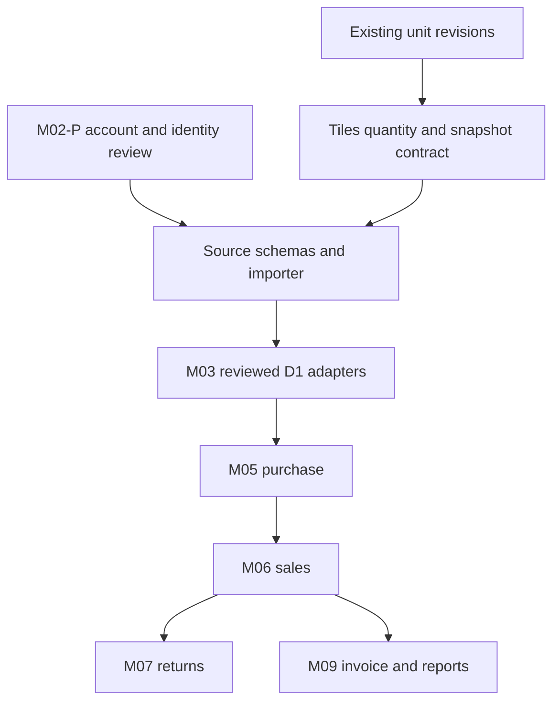

# M02 completion and tiles quantity contract implementation plan

> **For agentic workers:** Use superpowers:executing-plans, task by task. Steps use checkbox syntax. No parallel schema/kernel edits.

**Goal:** Complete the owner-requested M02 database/import foundation in reviewed dependency order, starting with the missing exact tiles quantity contract and an explicit 49-group gap matrix.

**Architecture:** Reuse products, immutable product_unit_profiles/product_unit_conversions, the existing product-unit-conversions.js resolver, and M03's single SQL posting boundary. A tile is a Pcs-stock product with a versioned measurement extension; area is a commercial quantity, never a second inventory.

**Tech Stack:** JavaScript ES modules, BigInt rational arithmetic, Node 22 node:test, SQLite STRICT, isolated local Workerd/D1 in GitHub Actions.

**Spec:** docs/superpowers/specs/2026-11-17-m02-tiles-foundation.md

## Global constraints

- Source: Mohim_ERP@29aa4a5c7a7062a49e6bf4758beda3a8d62d9ff2.
- Approved supplementary units: sherERP_Mohim@590adfad128fe7155bfb7b608a2ed5665b202a9c; issue #314 and PR #313.
- Baseline inspected: SherERP_Cloud/main@a7acd1013c3c90a4482bd1d8571193d18640a206; migrations 0001–0013.
- GitHub branch/PR only; all production code follows observed RED then GREEN.
- Public preview stays DB-free; no source business export, remote D1, auth/public RPC activation or deployment.
- Protected financial schema needs M02-P account/sign review and shared M03 ownership coordination.
- Keep original HTML/CSS/JS, original identifiers, ledger signs and historical source values unchanged.
- General units and tiles use the existing stock/FIFO/return engines; this PR cannot activate them.
- The initial planning session had no executor; the continuation uses a verified local checkout and real Workerd/D1. GitHub exact-head CI remains a separate gate; never substitute mock-only claims.

## Module overview (12 sentences)

1. The baseline inventories 49 canonical source groups and 659 source columns.
2. Thirteen numbered migrations currently provide partial schema coverage.
3. Thirty source groups still have no source-specific versioned destination.
4. Existing Party links represent identity rather than complete financial accounts.
5. Historical opening balances must remain separate from current cash activity.
6. The current product catalog already has immutable product unit revisions.
7. The approved supplementary multi-unit calculation core is already present.
8. PR #434 owns price-anchor configuration and must not be duplicated here.
9. Tiles add exact product-specific dimensions and coverage to that product model.
10. Physical stock stays whole Pcs while commercial area can be rational.
11. Later modules must persist one revision snapshot with atomic canonical stock and financial effects.
12. This task's initial independent slice delivers pure contracts and gap documentation; full M02 acceptance remains gated on the remaining schemas, importer and D1 reconciliation.

## Review focus

- Decimal representation: reject numeric/coerced, exponent, whitespace and excessive-precision input before BigInt.
- Coverage selection: manufacturer policy needs positive coverage and evidence; nominal never silently switches.
- Area ceiling: tiny positive decimal excess must increase physical Pcs; box-only must ceil packs.
- History: resolve an old snapshot after a new pack revision without reading current settings.
- Invoice arithmetic: exact coverage times price, one half-up line rounding, exposed displayed-quantity delta.

## Dependency graph

## Task 1 — Record source coverage and review boundaries (M02-A/B preparation)

**Files:** docs/reviews/2026-11-17-m02-completion-matrix.json; this plan and spec.
**Consumes:** frozen schema-inventory.json, actual 0001–0013 SQL, source coverage audit, ADR-007.
**Produces:** explicit mapping status, original headers, provenance/storage/constraint/ownership/history gaps for every group.

- [ ] Record all 49 groups without promoting table presence or synthetic proof to historical reconciliation.
- [ ] Review source amount/date/sign behavior for all missing financial tables before protected DDL.
- [ ] Obtain scoped M02-P account-kind/sign approval and M03 shared schema owner coordination before protected schema changes.
- [ ] Follow with small source-specific migrations/importers, not a universal JSON archive masquerading as an operational financial schema.

## Task 2 — Exact tiles quantity and pricing contract (independent M02-C slice)

**Files:** tests/m02-tile-quantity-contract.test.mjs; src/modules/tile-quantity-contract.js.
**Consumes:** explicitly supplied trusted immutable measurement revision; pack or requested-area input.
**Produces:** resolveTileQuantity(measurement,request), priceTileQuantity(measurement,request,pricingUnit,unitPriceText).
**No persistence or transaction writer.**

- [x] RED: commit the real behavioral tests before the production module.
- [x] Observe Foundation CI failing on absent tile-quantity-contract.js and link the run.
- [x] GREEN: bounded canonical decimal strings → reduced BigInt rationals; exact inch/cm/mm dimensions; nominal/manufacturer policy; whole pieces; safe adapter into existing multi-unit resolver.
- [x] Expose measurement snapshot, original requested area, delivered area, normalized Box+Pcs, original unit breakdown and exact price snapshot.
- [x] Exact pricing covers Pcs/Box/Sqft from the selected trusted price, without duplicating override precedence or posting.
- [ ] Run the full npm test suite plus unchanged source/build gates in CI; fix meaningful failures through RED/GREEN.
- [ ] Verify latest-main compare/mergeability and every exact-head check; leave owner review/merge gate intact.

## Task 3 — Reviewed measurement D1 migration (M02-C remaining)

**Proposed tables:** product_tile_measurement_revisions referencing existing product_unit_profiles and box conversion.
**Consumes:** reviewed SQL spec below, source pack/revision links and current 0013 catalog.
**Produces:** exact rational measurement persistence with immutable history; no tile stock table.

- [ ] Confirm shared schema owner and review, then reserve the next available migration number on fresh main.
- [ ] RED real local D1: missing parent/revision, wrong product/base unit, nonintegral pack, mismatched box factor, invalid rational or coverage evidence, immutable UPDATE/DELETE and revision selection.
- [ ] GREEN minimum extension migration, fixed parameterized mapper, FK/index/trigger constraints.
- [ ] D1 rollback/replay/concurrency and old/new pack-revision fixture readback; update all deterministic migration-count gates.
- [ ] Do not mark tiles database support complete until these real D1 tests pass.

## Task 4 — All-group offline importer and reconciliation (M02-D remaining)

**Consumes:** approved source-specific schemas and private-free synthetic source snapshots.
**Produces:** deterministic dry-run/plan → internal atomic import → original-ID/row/hash/reference/gross-account reconciliation.
**Existing reusable paths:** scripts/dry-run-*, src/party/*, src/db/*-import.js, src/migration/*.

- [ ] Complete source-specific adapters for all presently unmapped groups from canonical source contracts.
- [ ] Preserve typed IDs, physical row order, original amounts/dates/deletion/audit and original FIFO lots without retroactive tile factors.
- [ ] Require explicit reviewed-source manifest before optional supplementary conversions can be imported.
- [ ] RED/GREEN: duplicate/orphan/missing header/unsafe decimal/ambiguous Party/tenant-boundary/drift cases; clean-state import twice with identical hashes/counts.
- [ ] Real isolated Workerd/D1 import/readback and atomic late-failure rollback for every added slice.
- [ ] Keep actual private full-business export/import under M10.

## Task 5 — Integration and final acceptance (M02-E)

- [ ] Freeze M03 adapter DTO/schema version and single-authority posting boundary; extend existing readProductCatalogCandidateD1 for measurements instead of duplicating the product/unit reader.
- [ ] Review purchase/sales/returns/invoice contracts in the spec; do not activate downstream workflows.
- [ ] Reconcile all checklist items from the owner's M02 request with exact CI and local D1 evidence.
- [ ] Open small dependency-ordered PRs; no duplicate already-merged work, no auto-merge of protected financial changes.
- [ ] Report remaining blockers explicitly. Do not equate pure contract tests with D1 or production acceptance.

## Execution ledger

### 2026-11-17 continuation scope: catalog-bound quantity contract

Add `resolveTileQuantityFromCatalog(catalog,measurement,request)` within the same
internal tiles module, two behavioral tests, and an actual Workerd/D1 composition
test using the existing M03 catalog reader and unchanged 0013 schema. Validate
exact product/base-unit/revision/pack-factor agreement and preserve the native
pack label. Reuse the existing isolated product-catalog CI job. Measurement DDL,
M03 reader/kernel changes and posting remain excluded. RED must show the absent
export before implementation; GREEN must prove old 25-piece and current 24-piece
revisions using actual D1 without inventing measurement persistence or stock.

- Audit: 13 migrations; 49 canonical source groups; 30 no source-specific DDL; no full historical-data reconciliation certified.
- Existing PR #434 owns pure price-anchor profile work; no conflicting changes planned.
- Ruling: this branch leaves protected source/finance SQL untouched until the required M02-P/M03 review, and implements the safely independent pure tiles contract first.
- RED/GREEN and exact-head links will be recorded in the PR after observed results.

- Review checkpoint: existing M03 reader reused; protected account/sign review packet added. Initial RED Foundation run 43992235035 remains queued at observation; no production implementation or RED/GREEN claim.

### Verified continuation evidence

See `docs/reviews/2026-11-17-m02-tiles-contract-verification.md` for observed RED/GREEN, runtime, review and remaining gates. Local Node 22 suite: 2,473 passed; tiles: 27 unit + 3 real local Workerd/D1 composition tests. Existing catalog D1 suite: 5 passed. Latest main was merged without conflicts. Exact-head hosted CI must be checked after publication; M02 as a whole remains incomplete.

- Latest-main refresh: merged main c73c333c51ea0e90e8fac73c63efb4e906c43d54 without conflicts; Node 22/UTC full suite **2,525 passed, zero failed/skipped**.
