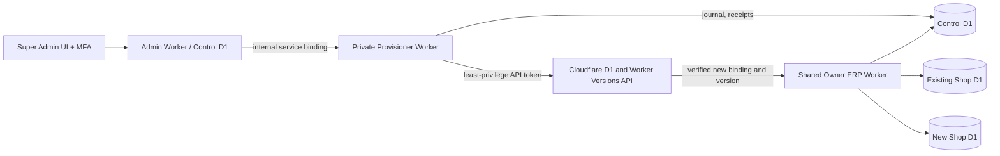

# M03 Option A: Automatic Shop D1 Provisioning from Super Admin — Design

**Status:** Proposed for owner review; Option A topology approved 2026-11-21. **Implementation and deployment are NOT authorized by this document.**

**User goal:** Once per Cloudflare account, install the platform and authorize an operator-owned provisioning service. Thereafter the Super Admin creates and manages shops from its UI without creating D1 databases, copying UUIDs, editing Cloudflare Workers Builds variables, or running SQL for individual shops.

**Selected topology:** One shared authenticated Owner ERP Worker (`shererp`), one Control D1, **one separate D1 database per shop**, and one private provisioner/deployment publisher. Preserve the current `admin` Worker, Google/TOTP, first Shop, and original ERP UI.

**Existing sources reused:** `docs/installation/PORT_P2_PROVISIONING_AND_RECOVERY_DESIGN.md`, `docs/architecture/PROPOSAL-saas-tenant-onboarding.md`, `src/auth/port-p4-local-provisioning.js`, `src/auth/m03-hosted-prebound-pilot.js`, `scripts/port-p2-provisioning.mjs`, `scripts/build-shop-user-deploy.mjs`, `docs/runbooks/M03_HOSTED_PREBOUND_PILOT.md`, and `docs/installation/START_HERE.md`. Supersedes no security, financial, or release gate in `AGENTS.md`.

## 1. Requirements and boundaries

- **One-time installation** may still require entering Cloudflare Account ID, Google OAuth client information, installing minimal protected secrets/permissions, and publishing the private Provisioner Worker. This cannot safely be made zero-authorization.
- **Every subsequent shop:** Admin enters business name and approved Owner Gmail once, then gets progress, errors, retry, database health, and a Ready result in the **existing** Control Center.
- Creating a shop is not evidence of operational financial readiness. Owner ERP endpoints and posting flags retain their independent approval gates.
- Existing shop records and databases must be preserved. No data migration, forced re-creation, Owner password reuse, or mass redesign.
- No arbitrary SQL editor, direct Admin modification of invoices/balances, automatic database deletion, account-plan purchases, or speculative billing/configuration panels.
- No dynamic D1 database ID from a browser request may select a binding. No runtime request may create an unreviewed public Worker or enable finance.
- Prefer one shared Worker for the initial account capacity. Enforce Cloudflare account limits and a bounded static-binding roster. Plan later sharding only when measured and explicitly approved.

## 2. Deployment architecture

**Provisioner boundary:** A dedicated **non-public** service Worker (or an equivalently isolated trusted publisher if the Cloudflare API cannot support safe version publication from Worker runtime) is the sole owner of Cloudflare D1 creation, migrations and protected Owner Worker version activation. It holds narrowly scoped account credentials as protected secrets, not in browser code, Owner Worker, public PR previews, or repository files. Admin communicates only through a Cloudflare service binding. The Provisioner independently checks a verified, current Google/TOTP-backed Admin session and exact operation authorization in Control D1; internal fetch alone is not an authorization bypass.

**Build ownership:** At most one process publishes the production `shererp` Worker. Existing Workers Builds must not auto-promote stale pilot configuration after a merge. Where useful, Builds may still upload versions without activating them, but **the private publisher** owns activation, full bindings roster and rollback. Code updates and tenant binding additions must use that same publisher; preserving only the previous deployment's database list is insufficient. Public preview Worker `hisabiq` remains D1-free.

**Static D1 bindings are intentional:** D1 is accessed through declared `env` bindings. Adding a shop generates an append-only Owner Worker binding roster and a **new Worker version**, which must be verified and promoted. A new database is not connected until that exact active version contains the binding. The publisher reuses an immutable, already-reviewed release artifact and verifies its hash before attaching bindings; it must not dynamically compile arbitrary code or use unchecked user-provided Worker names.

## 3. Shop creation state machine

Keep the existing reservation/operation ID and Owner approval workflow, with a durable Control D1 provisioning journal:

| State | Action and evidence |
| --- | --- |
| `reserved` | Authenticated Admin reserves immutable Shop UUID, operation ID, display name, normalized Owner Gmail, intent hash |
| `creating-database` | Capacity and account check, unique deterministic D1 name, persist create intent before Cloudflare call |
| `database-created` | Independently read back exact D1 UUID, name, account and attributable operation receipt; no name-only trust |
| `initializing` | Execute only pinned, versioned migrations on the verified empty Shop D1; install immutable shop identity/marker; read back migration ledger and schema |
| `publishing-binding` | Serialize against other publisher releases, preserve all existing bindings, upload immutable candidate version, verify exact binding map, promote and verify active version |
| `verifying` | Protected runtime read through new binding proves correct shop marker, approved schema/health, and current Owner routing |
| `ready` | Only now atomically publish binding eligibility and the approved Owner Gmail in Control D1. Existing Google Owner sign-in becomes available |
| `needs-attention` | Safe error code and last completed stage, no Owner readiness, operator-facing **Resume setup** |

**Exactly-once expectation:** One `operationId` always maps to one immutable business + intended database. Replays with identical input return the same progress. Changing name/Gmail under an existing operation conflicts. A timeout after a Cloudflare API call is **outcome unknown**, not permission to retry an unproven create. The Provisioner reconciles inventory/version receipts before advancing. A Control D1 lease/CAS serializes publisher operations; a lease alone must not be treated as remote API fencing.

The browser may poll **read-only** status and explicitly request **Resume setup**; it cannot choose D1 IDs, migration files, release SHA, token scopes or Worker bindings.

## 4. Tenant routing and Owner authentication

- On each Owner request, verify the current Owner session and its server-side shop membership first. Derive shop ID from that authority, never a query parameter.
- Resolve the shop ID to a **server-published, versioned binding registry** that includes the exact D1 UUID, marker, binding key, schema compatibility revision and minimum active deployment version.
- Require full agreement among current Control D1 ready placement, published Worker registry, exact bound `env` D1 object and Shop D1 immutable identity. Any missing/stale/swapped binding or suspended shop **fails closed**; never substitute the default pilot D1.
- Migrate the current `PLATFORM_PILOT_DB`/pilot-only paths incrementally behind a compatibility gate. The existing Shop retains its identity and records and is not re-created.
- Where one Gmail owns multiple verified shops, Owner login must require an explicit current-shop selection, then bind the session to that shop. No inferred cross-shop membership, account merging or shared transaction context.
- The support-only Super Admin visit remains separately time-limited, read-only by default and audited. It must resolve through the same verified tenant registry without impersonating an Owner.

## 5. Schema and migrations

Reuse the reviewed PORT-P2 create/migration receipts, PORT-P4 Create/Resume SQL, and pinned Shop migration source files. Add only the Control D1 journal, active deployment roster and schema compatibility records truly missing. A newly created Shop D1 must be empty; migration apply must be repeatable by exact checksum and stopped on drift. The current pilot's strict 13-step schema-snapshot check must be upgraded **by versioned compatibility evidence**, not disabled when product/purchase/POS migrations add approved tables.

Do **not** run migrations against existing active Shop business data as part of the create flow. Existing-Shop upgrades are a separate, backed-up release lane with independent financial acceptance and M10/M11 recovery approval.

## 6. Minimal Super Admin interface

Retain existing Create Business, roster, search, status and Resume setup. Add these controls **only when the backend supports them**:

- **Create business:** name + Owner Gmail; progress is read from Control D1, no database IDs or Cloudflare configuration fields.
- **Shop detail:** verified Shop UUID, Owner, Ready/Paused/Needs setup, database/ERP health, last provisioning stage, last safe error and **Resume setup**.
- **Owner access:** approved Gmail, access enabled/disabled; any Owner change requires an explicit audited, verified reapproval and session-revocation workflow.
- **Support:** existing audited Visit ERP and Shop activity logs; no unscoped database editing.
- **Recovery:** last successful backup/checkpoint indicator and operator-safe `Needs attention` status. Actual destructive restores require a separate approved procedure.

Never display provider API tokens, TOTP secrets, raw migration SQL, private owner subject IDs or reusable support bearer tokens in ordinary UI and logs.

## 7. Failure and security requirements

- **Unauthorized / wrong origin / stale MFA:** no platform mutation or provider API call.
- **Quota, credential denial, revoked token or throttling:** preserve journal, show safe error and retry instructions, do not partially activate a shop.
- **Double submit, concurrent shops, interrupted upload:** exactly one creation/placement per operation; serialize publishing; retain all existing bindings in every candidate version.
- **Wrong Shop binding or stale Worker after merge:** close the affected placement, preserve healthy shops, reconcile active version and roster before forwarding traffic.
- **Failed D1 migrations / incompatible schema:** Shop remains unready; do not enable Owner writes or bypass version checks.
- **Rollback:** rollback only to a version carrying **all reachable bindings** and a compatible code/schema revision; otherwise suspend affected placements and roll forward. Never automatically delete a D1 with data.
- **Security:** protect Admin and private Provisioner routes; independent API token scopes for D1 create/query and Worker version publication; require current Admin MFA, exact account/workers allowlist, CSRF/origin and rate limiting, immutable audit and short-lived internal authorization.
- **Capacity:** check current Cloudflare plan, database count, Worker binding count and paid/free quota **before** creating. Workers Free currently allows 10 D1 databases per account; database counts include Control D1. Do not treat plan upgrades as automatic.

## 8. Phased delivery and ownership

**Phase 0 — deployment ownership:** Secure the `shererp` production publisher; prove GitHub merges cannot restore the old pilot config. Preserve known-good Owner login. M03/M11 own this gate.

**Phase 1 — trusted provisioner:** Add backend-only provider adapter, Control D1 journal, exact replay/unknown-outcome reconciliation, capacity limits, secure service binding, and pinned migration apply. M03/M04/M10 review.

**Phase 2 — safe multi-Shop routing and Worker publication:** Convert the one-Shop binding to a versioned append-only roster; upgrade Owner session-to-D1 mapping; publish/verify one candidate version without losing current bindings. M03 owns shared Worker/auth files; coordinate M06/M07/M08 ownership.

**Phase 3 — Control Center UI:** Reuse existing Create/Resume/list UI, wire real progress and safe owner management; no Cloudflare settings per shop. M03 frontend-only slices and M04 review.

**Phase 4 — two-Shop release acceptance:** Two distinct new D1s, real Google Owner logins, no cross-shop reads/writes, interruption/retry, deployment conflict/rollback, backup/restore, limits, and secure Support Mode acceptance. M10/M11 review production readiness separately.

**Independent PRs** should be scoped to one file owner and contain red→green Workerd/D1/Playwright evidence. Never deploy, apply remote migrations or enable financial posting on the strength of this design approval alone.

## 9. Acceptance criteria

1. With an already installed Cloudflare account, a Google+MFA Super Admin creates **two** businesses from the current UI and does **not** edit Cloudflare database or Builds settings.
2. The two new shops and the pre-existing first Shop have unique verified D1 UUIDs/markers; same-named resources are not silently reused.
3. The Owner Worker serves all three only after the published registry and current Owner session authorize the exact Shop; deliberate wrong-binding and forged-client-ID attempts fail closed.
4. Business data and any enabled posting rules remain isolated. Same Gmail in two businesses requires explicit selection; no shared Owner session or implicit role.
5. Duplicate Create, network timeout during D1 create or Worker publish, bad migration checksum and out-of-quota requests cannot create duplicate/active corrupt tenants; Resume reconciles exact receipts.
6. GitHub merge cannot drop a Shop binding or overwrite the active private Owner Worker; rollback demonstrably preserves healthy shops.
7. Status, progress and meaningful safe error are visible in Super Admin, and the current Owner Google login and existing ERP UI stay unchanged.
8. No public preview can reach Control or Shop D1; secrets and deployment credentials remain protected. M10/M11 backup/restore and financial go-live gates remain separate.

## 10. Approval boundary

**Approved:** Option A topology (shared Owner Worker + per-Shop D1) and planning work.

**Pending:** Review of this detailed design, scoped file ownership and one-time Cloudflare publisher setup. After review, implement by scoped Superpowers TDD PRs. **No live mutation or deployment is requested here.**
